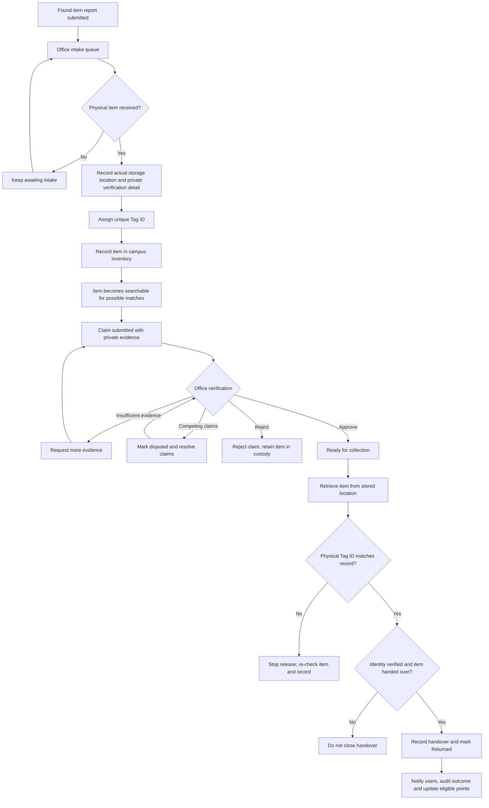
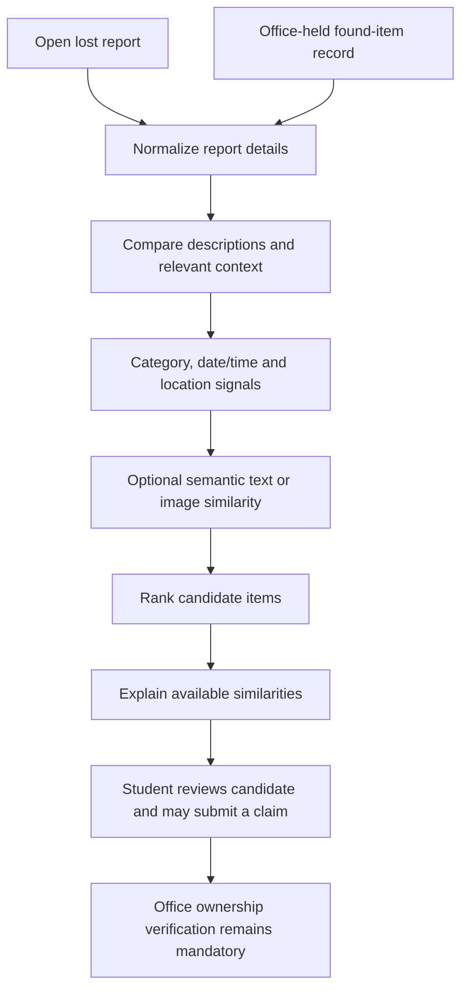
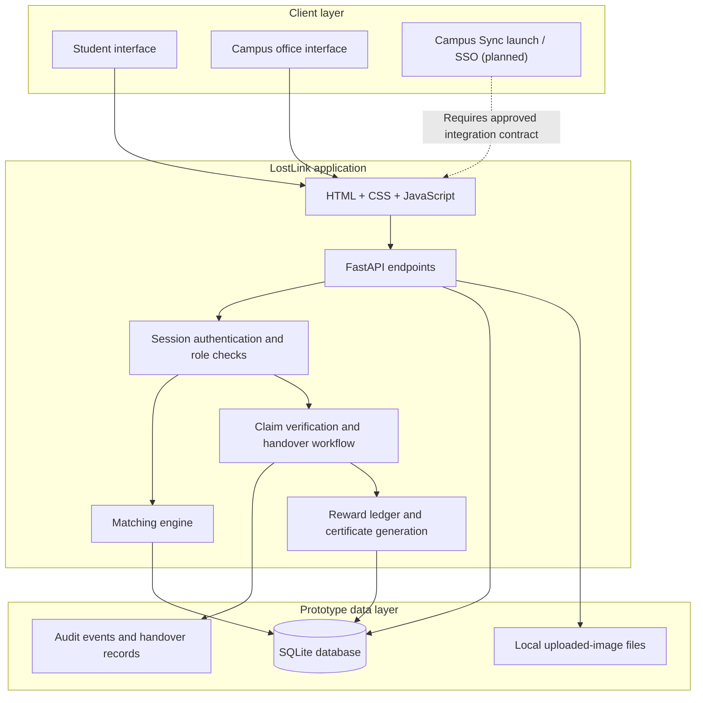
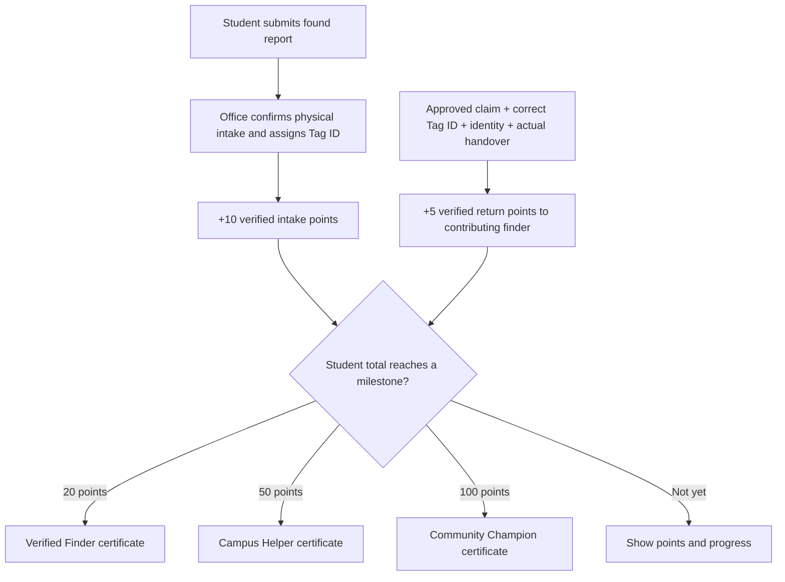

# LostLink — Round 1 Jury Overview
### AI-Assisted Campus Lost & Found | DejaVu Hackathon

> **One-line summary:** LostLink turns scattered lost-and-found reports into a traceable campus workflow: report → physically receive → tag and store → match → verify ownership → return using the exact Tag ID.

This document is designed for a first-round jury review. The diagrams use Mermaid and render directly on GitHub.

---

## 1. The problem we are solving

Students and staff lose personal belongings in classrooms, laboratories, libraries, cafeterias and other campus spaces. Found items may be announced through class groups, personal messages, verbal communication or informal desks. These channels are fragmented: the person who lost an item may never see the announcement, descriptions can be vague, and there is no consistent way to prove who owns an object or track whether it was returned.

Manual coordination becomes harder as report volume increases. A post saying “a bottle was found” may not distinguish it from similar bottles. Publicly sharing every detail can also expose information that a genuine owner should use to verify a claim.

### The core gap

| Typical difficulty | LostLink’s response |
|---|---|
| Lost and found information is scattered | One structured reporting and search interface |
| Descriptions use different words | Candidate matching using descriptions and context signals |
| People cannot tell why an item was suggested | Explanations show which available signals support a candidate |
| A submitted found report does not prove physical custody | Staff must confirm receipt before it appears in public search |
| An item can be misplaced after intake | Private Tag ID plus recorded room/cabinet/shelf location |
| A claim alone does not prove ownership | Private evidence, risk-based checks and identity verification |
| Approval can be confused with actual return | Claim approval and physical handover are separate states |
| Contributors receive little feedback | Auditable points and milestone recognition certificates |

## 2. Objective and scope

**Objective:** Build an AI-assisted, privacy-aware lost-and-found workflow that improves discovery while ensuring physical items are tracked and returned through an accountable staff process.

The prototype covers student lost/found reports, optional photos, search/filtering, possible-match suggestions and explanations, in-app notifications, office-confirmed intake, Tag ID assignment, campus storage records, private claim review, dispute handling, handover tracking, reward points and milestone PDF certificates.

**Scope boundary:** LostLink currently runs as a standalone web prototype. Campus Sync is the intended campus entry point, but a live Campus Sync connection, institutional SSO and production hosting have not been implemented. Integration depends on the college/platform’s approved API or SDK and authentication contract.

## 3. Solution at a glance

```mermaid
flowchart LR
    A["Student reports lost item"] --> D["LostLink report store"]
    B["Student reports found item"] --> C["Campus office receives physical item"]
    C --> E["Assign private Tag ID"]
    E --> F["Record real campus storage location"]
    F --> D
    D --> G["Search and candidate matching"]
    A --> G
    G --> H["Possible-match notification"]
    H --> I["Student submits private claim"]
    I --> J["Office reviews evidence and checks identity"]
    J -->|More evidence / dispute| I
    J -->|Verified claim| K["Ready for collection"]
    K --> L["Retrieve item using storage record"]
    L --> M["Check exact physical Tag ID"]
    M --> N["Confirm identity and actual handover"]
    N --> O["Mark returned and audit the outcome"]
    O --> P["Notify users and update contribution points"]
```

**Important design rule:** A match is a lead, not proof of ownership. Claim approval permits the collection process to proceed; it does not prove the physical item has already changed hands.

## 4. End-to-end workflow

### Stage A — Report and discover

Students can create lost or found reports with item title, category, description, approximate date/time, campus block/area, room/floor information and an optional image. Search supports keywords and filters including category, block/area, room and date.

Lost reports remain open while owners search. Found reports begin in **Awaiting office intake**. A found report is not available for other students to claim merely because a form was submitted.

### Stage B — Physical intake, tagging and storage

The finder brings the object to the designated campus custodian/office. An authorised office operator confirms receipt, records a private identifying detail or approved verification method, selects suitable sensitivity/value fields and enters the actual storage location. LostLink assigns a unique physical Tag ID and records the item in the campus custody inventory.

The location can include a campus room, cabinet and shelf reference according to the actual location system approved by the college. If staff move an item, they update its recorded location; the audit log stores the previous and new locations and the change metadata.

Exact Tag IDs and storage locations are not shown in public student search or student-facing notifications. The office console uses them to find and retrieve the right object.

### Stage C — Candidate matching and notifications

The matching engine compares a lost report with available office-held found items. It considers text/description and contextual signals such as category, time and location. Optional photo/model signals are available only when the corresponding mode is installed and enabled. Candidate explanations help users understand why a result might be relevant.

The default matcher is a deterministic, lightweight baseline. Optional pretrained Sentence Transformers and CLIP modes are not enabled by default. We do not claim a validated accuracy percentage or treat a similarity score as the probability that a person owns an item.

The system creates in-app notifications when it finds a possible match, including when a new lost report matches an item already in custody or a newly received found item may match an existing lost report.

### Stage D — Claim verification and dispute handling

The claimant submits private ownership evidence. Authorised office staff review the evidence and an item-risk-based verification checklist. The workflow requires claimant identity verification; restricted/high-sensitivity items also require an authorised-record/custodian check. Competing active claims hold the item for review rather than allowing automatic first-come-first-served release.

Office staff can approve, reject, request more evidence or mark a claim disputed. The claimant can see their own claim status but not internal review notes or another claimant’s private evidence.

### Stage E — Physical return by Tag ID

After approval, the claim enters **Ready for physical handover**. Office staff retrieve the item from its recorded storage location, inspect the physical tag and enter the exact Tag ID. They confirm the claimant’s identity and that the item was actually handed over.

A wrong tag, an unapproved claim, or a duplicate handover is rejected. A valid handover is recorded with item, tag, claimant, office operator and timestamp. The claim/report is marked **Returned**, relevant users are notified, and eligible verified-contribution points can be awarded.

## 5. How the Tag ID and storage register help

The Tag ID is the private identifier connecting a digital record to a physical object. It should be placed on a physical label after the item has been accepted by the campus custodian.

| Inventory field | Why it matters |
|---|---|
| Public report reference | Lets students discuss a record without exposing the private Tag ID |
| Private physical Tag ID | Lets office staff identify the exact item at collection |
| Recorded storage location | Helps staff find the item within campus storage |
| Private verification detail/method | Supports controlled ownership review without exposing the answer publicly |
| Sensitivity/verification level | Enables stronger checks for sensitive items |
| Location-change audit event | Records an internal move from one location to another |
| Handover record | Captures the approved claim, tag, claimant, office operator and time of return |

A Tag ID alone does not prove ownership. The return still requires claim verification and an identity check. The storage field is a custody record, not a sensor: staff must physically place the item at that location and update the record after moving it.

## 6. AI-assisted matching: what it does and does not do

The optional model stage is active only if its dependencies are installed and the configuration flag is enabled. The default path is a deterministic baseline using available text and contextual signals. This gives the prototype a reproducible starting point before heavier models are evaluated.

**Why keep a human in the loop?** Objects can look alike, descriptions can be incomplete, and people can make mistaken reports. Matching narrows the search; only authorised verification and physical handover close the recovery.

**Evaluation still needed:** Build a labelled campus dataset of lost/found pairs and measure top-k usefulness, false suggestions and missed matches. Do not present an unmeasured score as accuracy.

## 7. Technical architecture

### Technology stack

| Layer | Technology | Role in the prototype |
|---|---|---|
| Backend | Python + FastAPI | HTTP API and business workflows |
| Request validation | Pydantic | Validate request fields and constraints |
| Persistence | SQLite | Users, reports, claims, checks, notifications, inventory, handovers, rewards and audit records |
| Frontend | HTML, CSS, vanilla JavaScript | Student and office interfaces |
| Image handling | Pillow | Validate/re-encode photos, correct orientation and remove embedded image metadata |
| Matching baseline | Deterministic text and context comparison | Rank candidates and generate explanation signals |
| Optional ML | Sentence Transformers and CLIP | Optional pretrained semantic/image comparison when installed and enabled |
| Certificates | ReportLab | Generate milestone recognition PDFs |
| Quality checks | unittest + GitHub Actions | Workflow tests, Python compilation, JS syntax and application import |

The current persistence layer uses local SQLite and a local filesystem. Production use requires college-approved hosting/database infrastructure, secure object storage, backups, retention policy, monitoring and concurrency/security review.

## 8. User roles and access boundaries

| User | Main actions | Information boundaries |
|---|---|---|
| Student / finder | Report found item, attach photo, track own reports, receive notifications and recognition | Cannot see private tags, exact storage, internal verification details or private claim evidence |
| Student / claimant | Search available items, submit private evidence, track own claim | Can see own status; cannot see reviewers’ internal notes or another claimant’s evidence |
| Authorised office staff | Confirm intake/storage, inspect private fields, review disputes, update storage, verify tag and record handover | Office operations require an office-role session |
| Campus Sync identity provider (future) | Intended source for institutional identity/sign-in if supported and approved | Not integrated; precise role mapping/SSO depends on the approved contract |

## 9. Rewards and certificates

LostLink rewards verified contributions rather than unverified form submissions.

| Verified event | Prototype reward |
|---|---:|
| Found item physically received and tagged by office staff | +10 points |
| Office records a verified physical return after an approved claim | +5 points |
| Total reaches 20 points | Verified Finder |
| Total reaches 50 points | Campus Helper |
| Total reaches 100 points | Community Champion |

Unique event keys prevent the same event from awarding points repeatedly through a retried request. Certificates are downloadable PDFs and state they are prototype recognition documents, not official CVR College credentials. A real college recognition policy and certificate branding must be approved before institutional use.

## 10. Coverage of the problem statement outcomes

| Expected outcome | Current prototype coverage |
|---|---|
| 1. Submit lost/found reports with descriptions, categories, dates and locations | **Implemented** — structured reports and validation |
| 2. Upload optional photographs | **Implemented** — optional upload with format/size validation and re-encoding |
| 3. Search/filter by type, location, date and keywords | **Implemented** — keyword, category, block, room and date filters |
| 4. Suggest potential matches using AI-assisted comparison | **Partially implemented** — baseline matcher is available; pretrained modes are optional and disabled by default |
| 5. Explain similarities behind suggested matches | **Implemented at prototype level** — explanations are based on available comparison signals |
| 6. Notify users about potential matches | **Implemented** — in-app notifications, including both report-arrival orders |
| 7. Verify ownership before return | **Implemented at prototype level** — private evidence, risk-based checklist, identity requirement and extra restricted-item check |
| 8. Track reports from submission to recovery/closure | **Implemented** — intake, availability, claim-review and returned states |
| 9. Office tools for reports and disputed claims | **Partially implemented** — intake queue, claim/dispute review, handover queue and audit events; a separate abuse-reporting/moderation subsystem is not present |
| 10. Protect personal/sensitive details | **Basic prototype controls implemented** — role-aware output and restricted fields; full production security review remains necessary |

## 11. Round 1 demo plan

Show one item all the way through rather than a collection of isolated screens.

1. **Discovery:** Sign in as a student and open the seeded lost-backpack report. Show possible matches and reasons.
2. **Physical custody:** Submit a new found-item report. Sign in as office staff, confirm receipt, enter a demonstration storage location and private identifying detail, then assign the Tag ID.
3. **Traceability:** Open the campus storage register and point out the private Tag ID and location. Update the location to demonstrate an audited internal move.
4. **Safe recovery:** As a student, submit a private claim for an available found item. As office staff, review evidence and complete the required checks.
5. **Release control:** Approve the claim, then record physical handover using the exact Tag ID and identity confirmation. Explain why approval and return are distinct states.
6. **Accountability:** Show notification updates, the returned status and Activity & Certificates for eligible verified points.

Only confirm actions that have actually occurred in the physical demonstration. A UI click records an event; it does not physically move or verify an item.

## 12. Suggested 60-second jury pitch

> “LostLink is an AI-assisted campus lost-and-found system that makes recovery traceable from report to physical return. Students can report lost or found items, search structured records and receive explainable match suggestions. The key difference is that we do not treat a submitted form or an AI match as proof that an item is recovered. A found object becomes searchable only after campus staff physically receive it, assign a unique Tag ID and record where it is stored. When a student claims an item, authorised staff review private evidence, verify identity and resolve competing claims. At collection, the physical Tag ID must match the approved record before the handover can be closed. We also track in-app updates and reward verified contributions. The current build is a working standalone prototype; Campus Sync is our intended integration path and requires the college’s approved authentication and integration contract.”

## 13. Likely jury questions

**Q. What makes this different from a WhatsApp group or notice board?**  
A. Structured search, match explanations, a physical-custody gate before public listing, private Tag ID/storage tracking, risk-based claim verification and a separate physical handover record.

**Q. Does AI decide who owns an item?**  
A. No. Matching ranks possible candidates and explains available similarities. Ownership is checked through the office verification workflow and identity checks.

**Q. How do you prevent someone claiming the first similar-looking object?**  
A. Claim evidence is private, staff review a risk-based checklist, competing active claims are held for resolution, identity must be checked and the physical Tag ID must match before handover.

**Q. How will staff find an item after it is handed in?**  
A. The office records the actual room/cabinet/shelf location and Tag ID during intake. That location can be updated after an item is moved, with the change written to the audit trail.

**Q. Is it already integrated with Campus Sync?**  
A. Not yet. The prototype is standalone. Integration is planned through the college-approved API or supported SSO/launch capability once the technical contract and deployment requirements are available.

**Q. What data proves matching accuracy?**  
A. The current prototype does not claim a validated accuracy percentage. We plan to measure matching usefulness and false suggestions against a labelled dataset of campus report pairs.

**Q. Is this production-ready?**  
A. It is a working prototype with automated workflow checks, not a production deployment. Institutional identity, approved hosting/database, backups, retention, operational controls and a security review are still required.

## 14. Risks, limits and next steps

| Area | Current state | Next step before real campus use |
|---|---|---|
| Campus Sync | Planned integration only | Obtain API/SDK, SSO, app-launch and deployment requirements |
| Identity | Standalone prototype login and role session | Replace with approved institutional authentication and explicit office-role assignment |
| Storage | Private location field and audit on moves | Agree actual storage rooms, custodians, label format and inventory policy |
| Matching quality | Deterministic baseline; optional models | Build labelled data; benchmark top-k results, false positives and missed matches |
| Data persistence | Local SQLite and local uploaded files | Choose college-approved database/object storage, backups and retention |
| Privacy/security | Basic role and output restrictions | Review sessions, CSRF, rate limiting, uploads, access controls, logs and incident handling |
| Rewards/certificates | Prototype rules and thresholds | Get approval for recognition policy and certificate wording |
| Operations | Office steps represented in software | Train designated staff and test actual intake/storage/release |

### Recommended priorities

1. **Before the jury demo:** Rehearse the end-to-end physical-custody story, use consistent sample data and demonstrate the Tag ID check.
2. **After jury feedback:** Agree Campus Sync integration and authentication requirements with the relevant administrators.
3. **Before rollout:** Validate matching on labelled data, review privacy/security, define retention and operating procedures, and test with campus staff.

## 15. Closing statement

LostLink is more than a place to post lost items. It connects digital discovery to physical custody, private verification, a traceable Tag ID and a recorded handover.

**Make items easier to find, but make their release accountable.**
